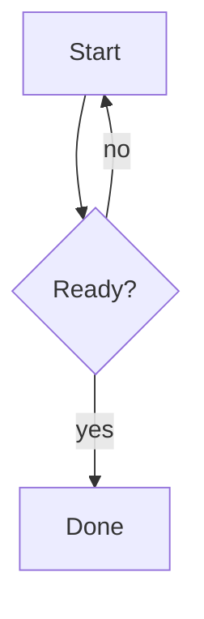

# dsh-handy-toolkits

A DeepSeek Harness plugin package. It ships three toolkits:

1. **Whole-page zoom** — the desktop window has no page zoom of its own (its
   `Cmd/Ctrl` `+` / `-` chords step font sizes), so this toolkit scales the
   document root and remembers the level.
2. **Copy on select** — dragging over a reply in the chat puts the text on the
   system clipboard immediately, with a short confirmation.
3. **Mermaid diagrams** — a ` ```mermaid ` fence in a reply is drawn as the
   diagram instead of a wall of highlighted text. The engine ships inside the
   plugin, so nothing is fetched at runtime.

## Whole-page zoom

| Chord (macOS) | Chord (Windows/Linux) | Effect |
|---|---|---|
| `Cmd + Shift + =` | `Ctrl + Shift + =` | Zoom in 10% |
| `Cmd + Shift + -` | `Ctrl + Shift + -` | Zoom out 10% |
| `Cmd + Shift + 0` | `Ctrl + Shift + 0` | Reset to 100% |

- Range 50%–200%, 10% per press; a small readout shows the new level.
- The level persists in `localStorage` (`dsh-handy-toolkits:level`) and is restored on
  the next boot. 100% is never stored.
- Shift is required on purpose: without it the chords belong to the built-in
  font-size commands, and hijacking them would break text sizing.
- Disabling the plugin restores 100% and detaches its listeners.

## Copy on select

Drag across a reply, a code block, or a whole turn: when the pointer is
released the selected text is already in the system clipboard. A readout in the
corner confirms the copy (`已复制 N 个字符` / `Copied N characters`) and says so
when the clipboard is not reachable.

- Scope is the transcript only: `[data-conversation-scroll]` (the message
  scrollport) and `[data-chat-turn]` (message rows). Selections in the composer,
  the sidebar, and the settings pages keep their native behaviour, and the
  composer's rich-text editor owns its selection outright.
- Empty selections and accidental `Cmd/Ctrl + A` selections (over 200 000
  characters) are ignored, so nothing huge is silently written to the clipboard.
- Text is written with `navigator.clipboard.writeText`; when that is unavailable
  (or denied) it falls back to `document.execCommand("copy")` on the live
  selection, then on a scratch node.
- `Cmd/Ctrl + C` still works as before — this only removes the second step.

## Mermaid diagrams

A fence tagged `mermaid` renders as the diagram itself:

````text

````

- Any diagram mermaid supports works (flowchart, sequence, class, state, ER,
  gantt, pie, mindmap, timeline …), in the chat transcript and in the history of
  reloaded sessions.
- The source stays available: an unparseable fence keeps its code block and adds
  one line with the reason (`Mermaid: Parse error on line 2`), and a fence that
  has not finished streaming is left as code until the turn ends.
- The diagram follows the app theme — switching light/dark redraws it — and it
  scales with the whole-page zoom like any other content.
- Mermaid runs with `securityLevel: "strict"`, so HTML inside labels is not
  evaluated. Labels are still text from the model: treat a diagram as untrusted
  content, like any other reply.
- The engine (mermaid 11.17.2, `dist/mermaid.min.js`) is gzipped and stored in
  `lib/client.js`; the app downloads it once with the bundle (~1 MB over the
  wire, cached immutably per revision) and the browser only inflates and runs it
  when the first `mermaid` fence appears.

### Viewing and copying

Hover a diagram (or tab onto it) and two actions appear in its corner:

- **Copy ▾** — `PNG`, `SVG`, or the mermaid source. PNG and SVG are written to the
  clipboard as images, so a paste into a document, a chat, or a slide deck lands
  as a picture; the source is copied in a fenced block so it can be edited again.
  A readout confirms which format went out (`已复制 PNG` / `Copied PNG`), and says
  why when the browser refuses the clipboard.
- **Full screen** — opens the diagram in a viewer over the app: `+` / `−` step the
  scale, the percentage button returns to 100%, `适应` fits the window, the wheel
  zooms around the pointer, dragging pans, a double-click toggles fit and 100%,
  and `Esc` (or a click beside the diagram) closes it.

Details worth knowing:

- **100% means one diagram pixel per app pixel at the current page zoom.** With
  the page at 150% a 100% viewer shows the diagram at the size the transcript
  draws it. The viewer is a real overlay, not a zoomed copy, so it follows the
  page-zoom chords while it is open: the window resizes and the diagram is
  re-fitted around the same point.
- The scale runs from 25% to 800%. Opening a small diagram never enlarges it
  past 100%, so "full screen" on a two-node graph does not fill the monitor with
  two giant boxes.
- A copy uses the diagram as it looked when the overlay opened — the theme is
  captured at open time, so toggling light/dark in the app does not change the
  image you are about to paste. Close and reopen to pick up a new theme.
- PNG is rasterised at 2× and needs the labels drawn as SVG text, so the copy
  re-renders the same source once with `htmlLabels: false`: the SVG shown in the
  transcript uses `<foreignObject>` labels, which a canvas silently drops. The
  background is filled with the theme colour so a dark diagram stays readable on
  a light page.
- Copying needs a focused window; if the browser rejects the clipboard the
  readout says so and the diagram itself is untouched.

## Install

Quit DeepSeek Harness completely (`Cmd + Q`), then:

```sh
./install.sh            # desktop profile
./install.sh web        # another profile name
```

The script copies the package to `~/.dsh/profiles/<profile>/plugins/dsh-handy-toolkits`
and appends one Loader entry to `~/.dsh/profiles/<profile>/cordis.patch.yml`:

```yaml
- insert:
    - id: dsh-handy-toolkits
      name: "./plugins/dsh-handy-toolkits/lib/index.js"
```

A patch entry can only edit an existing row, so the entry is added through a
patch's `insert` list rather than as a bare row.

Then reopen DeepSeek Harness. No package manager, dependency, or build step is
involved: the browser bundle at `lib/client.js` is already in the
`window.__ModuleLoader__.load({ id, factory })` form the client module host
serves.

### Manual install

```sh
profile=~/.dsh/profiles/desktop
mkdir -p "$profile/plugins"
cp -R dsh-handy-toolkits "$profile/plugins/dsh-handy-toolkits"
printf '%s\n' '- insert:' '    - id: dsh-handy-toolkits' '      name: "./plugins/dsh-handy-toolkits/lib/index.js"' >> "$profile/cordis.patch.yml"
```

## Uninstall

```sh
./uninstall.sh          # desktop profile
./uninstall.sh web
```

Removes the Loader entry (leaving a `.bak` copy of the patch file) and deletes
the plugin directory. Quit the app first.

The package is also a DSH **bundle** (`dsh.bundle.patch` → `cordis.patch.yml`),
so once it is on npm it installs the normal way — Plugins → Add plugin → the
package name — instead of through `install.sh`.

## Publish

See [PUBLISH.md](PUBLISH.md) for the full checklist: manifest requirements
(`dsh.bundle.patch`, `dsh.client`, `engines.dsh`), `npm publish`, how to test the
install without publishing, and how to get listed in a plugin market (format-1
index for the Discover page, or a PR to `awesome-dsh-plugin`).

## Test

```sh
npm test        # node --test: chords, persistence, clamping, coordinate shim, copy, scope, fence layer, teardown
```

Refresh the vendored engine after a mermaid release:

```sh
node scripts/vendor-mermaid.mjs            # 11.17.2, the pinned version
node scripts/vendor-mermaid.mjs 11.18.0    # another version from npm
node scripts/vendor-mermaid.mjs ./mermaid.min.js
```

## Verify

1. Reopen the app and look at 设置 → 插件: a row `dsh-handy-toolkits` should be enabled.
2. Press `Cmd/Ctrl + Shift + =` twice: the page (sidebar, transcript, buttons)
   grows, and the readout says `Page zoom 120%`.
3. Quit and reopen: the level is still 120%.
4. At 150%, open a menu (the sidebar `More`, a model picker): it opens flush to
   its trigger (`dx`/gap of a few px), and near the window edge it flips inside
   instead of hanging off screen.
5. Drag across a reply in the transcript: a `已复制` / `Copied` readout appears
   and `Cmd/Ctrl + V` elsewhere pastes that text.
6. Ask the agent for a mermaid diagram, or paste one as a reply: the fence turns
   into a drawn diagram, and switching the app between light and dark redraws it
   in the new palette.

Screenshots from that check (headless Chromium, real GUI, 1440×900): `docs/zoom-100.png`,
`docs/zoom-150.png`, `docs/zoom-200.png`.

## How it works

- `lib/index.js` — host half, an empty `apply()`; it exists so the Loader has an
  enabled row.
- `lib/client.js` — browser half, three toolkits sharing one bundle and one
  readout node. The zoom toolkit restores the stored level, sets
  `document.documentElement.style.zoom`, and installs a capturing `keydown`
  listener; the copy toolkit installs a capturing `pointerup` listener on
  `document` and reads `window.getSelection()` synchronously, while the pointer
  gesture still counts as user activation for the clipboard write. `event.code` (physical key) keeps the chords layout-independent, and
  `preventDefault` + `stopImmediatePropagation` keep them from reaching other
  handlers.
- CSS `zoom` on the root scales layout, text, and hit-testing together in
  Chromium, so pointer coordinates stay correct — unlike a `transform: scale()`.
  Fixed-position surfaces scale with the root instead of detaching from it.
- **Coordinate shim.** Painting is scaled, but the JavaScript coordinate space is
  not: `getBoundingClientRect()`, `innerWidth`/`innerHeight` and
  `visualViewport` keep reporting *visual* (zoomed) pixels, while `style.left`/
  `top` and `event.clientX` stay in *layout* pixels. The GUI positions menus and
  popovers with `getBoundingClientRect()` and writes those numbers to
  `left`/`top`, so a bare `zoom` pushes every anchored surface `level ×` away
  from its trigger (a menu 250 px below its button at 150%), and edge clamping
  measured against the visual viewport lets menus hang off the window. While a
  level other than 100% is active the toolkit divides the visual APIs by the
  level — `Element.prototype.getBoundingClientRect`, the root's
  `clientWidth`/`clientHeight`, `innerWidth`/`innerHeight`,
  `visualViewport.width`/`height` — so the app measures and places in one space,
  the same one native page zoom exposes. Every patch is undone at 100% and on
  teardown.
- **Mermaid fence layer.** The chat asks `conversation.chat.markdown.fence` for a
  component around every code fence, keyed on the fence language; the plugin
  registers one layer with `key: "mermaid"` through `ctx.slots.inject`. The layer
  gets `lang`, `code`, `streaming` and the plain code block as `children`: it
  renders `children` while streaming or when the engine rejects the diagram, and
  otherwise a `div` whose `dangerouslySetInnerHTML` holds the engine's SVG. One
  engine load is shared by every diagram on the page; a `MutationObserver` on
  `body[data-ds-dark-theme]` starts a redraw from `componentDidUpdate`, because
  React batches `setState` — drawing inside the theme callback would still read
  the theme that was just replaced.

## Troubleshooting

- **Chords do nothing** — the plugin is not enabled, or the bundle is missing:
  check 设置 → 插件 for a load error, then quit and reopen the app.
- **`Page zoom` readout appears but nothing grows** — another plugin sets a
  `zoom` on the root element; only one can own it.
- **A menu lands far from its button** — this is the pre-0.2.1 bug: CSS `zoom`
  was applied without the coordinate shim, so the app placed the menu with visual
  pixels but in a layout-pixel slot. Upgrade to 0.2.1 (or reset to 100% and zoom
  again so the shim installs).
- **Text looks blurry** — CSS `zoom` re-rasterizes text, but fractional levels
  (110%, 130%) can look softer than 100% or 150%. Use the reset chord to return
  to a crisp 100%.
- **Selection copies nothing** — the selection has to start inside the
  transcript (`[data-conversation-scroll]` / `[data-chat-turn]`). Selecting in the
  composer or the sidebar never copies. If a future UI drops those attributes the
  toolkit stays quiet instead of guessing at a scope.
- **`Copy failed` readout** — the clipboard API was rejected (window not focused,
  permission denied). `Cmd/Ctrl + C` still works; focus the window and the next
  drag copies again.
- **The entry is red in 设置 → 插件** — verify the path: the Loader resolves
  `./plugins/...` against the profile directory, so the file must be at
  `~/.dsh/profiles/desktop/plugins/dsh-handy-toolkits/lib/index.js` (a directory or a
  bare `index.js` will not resolve).
- **A `mermaid` fence stays a code block** — the turn is still streaming (the
  diagram appears when it ends), the diagram has a syntax error (one line names
  the reason under the code block), or the layer never mounted (check 设置 → 插件
  for a load error). A very heavy diagram can also fail on the engine side; the
  message is shown verbatim.
- **The diagram is bigger/smaller than the text around it** — mermaid sizes
  labels with its own font stack; the layer passes `fontFamily: "inherit"` so the
  SVG follows the app's font settings, and the whole diagram scales with page
  zoom like any other content.
- **Content runs off the right edge** — this is real zoom, not a smaller layout
  viewport: at 200% on a narrow window the UI legitimately needs more room. Zoom
  out, widen the window, or hide the sidebar.
- **No Copy / Full screen buttons on a diagram** — the actions appear on hover or
  keyboard focus; if they never show, the layer is the older 0.3.0 build (check
  the version in 设置 → 插件) or the SVG fell back to a code block because the
  diagram failed to parse.
- **`Copy failed: Document is not focused`** — the window lost focus (another app,
  a headless session). Click the app window and copy again. The same message
  appears for any clipboard rejection, including a denied permission.
- **A pasted PNG has no labels** — the raster path re-renders with
  `htmlLabels: false`; if labels are still missing the diagram probably draws text
  via a foreign object the engine cannot flatten (some `mindmap` layouts). Copy
  SVG instead — it keeps the text as real text.
- **The full-screen viewer is offset to one side under page zoom** — the viewer
  measures the window in layout pixels and never calls `getBoundingClientRect`, so
  this means it was built without the coordinate shim (page zoom below 0.2.1) or
  another plugin resized the root. Reset page zoom to 100% and reopen the viewer.
